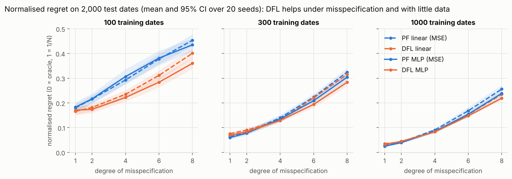
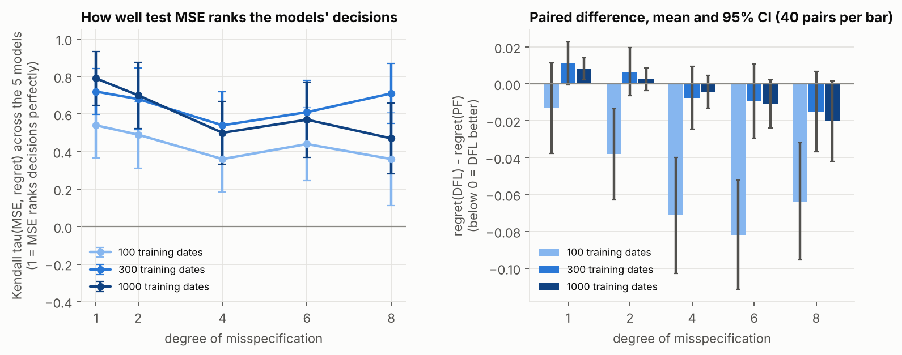
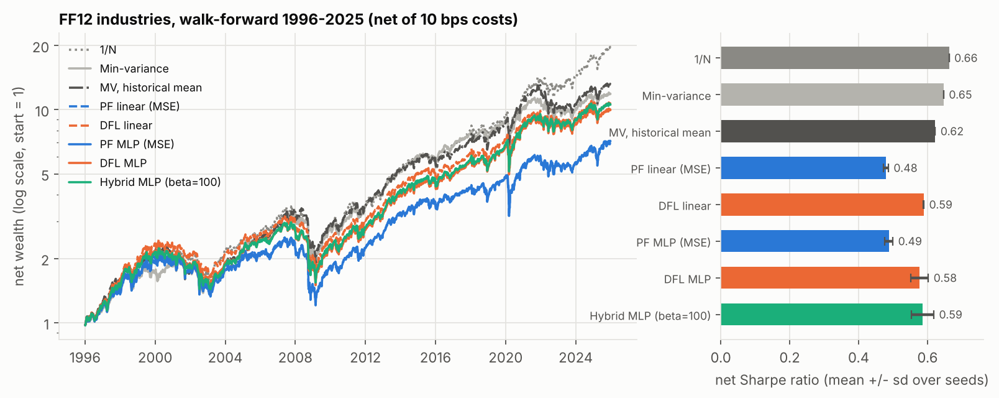
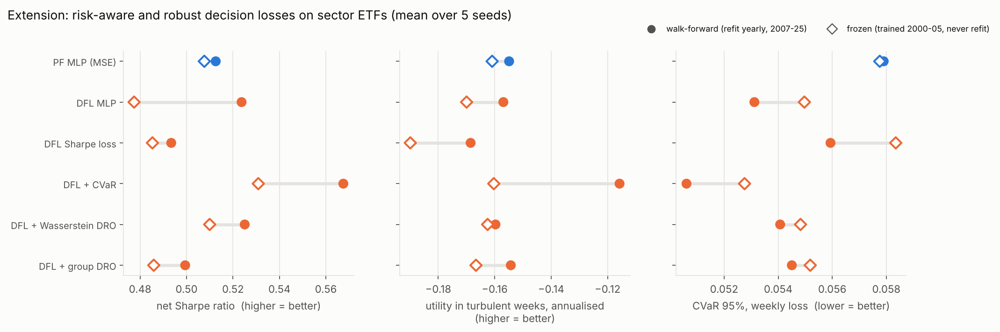

<div align="center">

# Decision-focused learning for portfolio optimisation

**Train a return predictor *through* a differentiable mean-variance portfolio layer, and find out when that beats "predict, then optimise".**


[](LICENSE)

</div>

AI4403 *AI in Finance* (IIT Hyderabad, 2026), Project 4. The repository contains an exact, batched, differentiable
portfolio layer; a leakage-safe walk-forward benchmark; synthetic markets with known expected returns; ablations of
the layer; and CVaR / distributionally robust decision losses. Every number in the write-up is regenerated by one
command.

```
features x_t ──► predictor f_θ ──► μ̂_t ──► portfolio layer ──► w_t ──► realised utility on r_{t+1}
                                     ▲          argmax μ̂ᵀw − λ wᵀΣ̂w − η‖w − w_{t−1}‖₁        │
two-stage (PF):  θ fitted by MSE(μ̂, r)│          s.t. 1ᵀw = 1, 0 ≤ w ≤ u                       │
decision-focused (DFL): θ fitted by ──┴──────────── gradient of realised utility ◄───────────────┘
```

**Where to start**

| I want to… | Go to |
|---|---|
| read the full write-up (method, experiments, answers to the three research questions, limitations) | [`REPORT.md`](REPORT.md) |
| see the layer and the main effect in about a minute | [`dfl-portfolio/notebooks/demo.ipynb`](dfl-portfolio/notebooks/demo.ipynb) |
| run it on my machine | [Quick start](#quick-start) (Windows, macOS and Linux) |
| use the layer in my own code | [Using the layer on its own](#using-the-layer-on-its-own) |
| understand what was wrong with the first prototype | [`dfl-portfolio/notebooks/NOTEBOOK_REVIEW.md`](dfl-portfolio/notebooks/NOTEBOOK_REVIEW.md) |

---

## What is in the box

- **An exact differentiable layer** (`src/dfl_portfolio/layers.py`). Batched ADMM forward pass, polished to the exact
  active set; backward pass by the implicit function theorem on that active set. Checked against CVXPY (≈1e-11),
  finite differences (≈1e-10) and the closed form (≈1e-13). It solves 1,200 nine-asset problems in about 0.1 s.
- **A fair PF-vs-DFL benchmark.** Same features, model, covariance, layer and backtest. Only the training loss differs.
  Expanding-window walk-forward with a validation year and an embargo, drift-aware turnover, 10 bps costs, block
  bootstrap and Jobson-Korkie-Memmel tests.
- **Controlled synthetic markets** with known μ, so decision regret is exact and misspecification is a dial.
- **Three real universes:** 9 SPDR sector ETFs, 12 Fama-French industries, and 10 mega-caps (hindsight-selected, secondary only).
- **Diagnostics for failure:** the share of training dates whose decision sits at a vertex (zero gradient) is logged every epoch.
- **Extension:** CVaR, Sharpe, Wasserstein-DRO and group-DRO decision losses, tested under regime shift.
- **18 tests** covering the layer, no-lookahead features, leak-free splits and backtest accounting.

## Results at a glance

**RQ1: lower prediction error does not mean better decisions.** Synthetic markets with known μ (20 seeds, paired):

- PF wins when the predictor is well specified and data are ample (regret +0.010 for DFL, p = 0.005).
- DFL wins under misspecification (−0.011 to −0.014, p < 0.01) with the same or *higher* MSE.
- DFL also wins with little data (−0.04 to −0.08 at n = 100).
- Under misspecification, test MSE ranks the models' decisions much less reliably (Kendall τ about 0.75 → 0.5).
- The gains do not survive a doubling of volatility at test time.

**RQ2: stability.** The failure mode is *vertex decisions*: when forecasts are large relative to λΣ, or caps are tight,
every weight sits on a bound and the gradient is exactly zero. DFL is stable with:

- λ ≥ 5 (weekly units) and caps of 20–30%;
- output scaling and a warm start from MSE;
- early stopping on the decision loss;
- transaction costs in the *loss* rather than as an ℓ₁ penalty in the layer, which pins weights and starves the gradient.

Without refitting through a regime shift, plain DFL degrades more than PF, and adding a CVaR term fixes this.

**RQ3: calibration.** Pure DFL forecasts are biased and poorly calibrated (calibration slope 0.25 vs 0.72 for PF on
sector ETFs). The decision does not depend on the forecast level, so DFL never learns it. A hybrid loss with a small
MSE term restores calibration and keeps DFL's decision quality.

**Real data** (net of 10 bps costs, walk-forward, mean over seeds; `results/tables/real_data_overview.md`):

| Universe | 1/N | PF MLP | DFL MLP | Hybrid | DFL − PF Sharpe, 95% CI | Turnover/yr PF → DFL |
|---|---|---|---|---|---|---|
| FF12 industries 1996–2025 | 0.663 | 0.488 | 0.577 | 0.586 | **+0.09 [+0.01, +0.17]**, p = 0.02 | 24.6 → 13.3 |
| Sector ETFs 2005–2025 | 0.651 | 0.548 | 0.568 | 0.566 | +0.02 [−0.06, +0.12], p = 0.61 | 25.4 → 14.7 |
| 10 mega-caps 2017–2025 | 1.290 | 0.938 | 0.823 | 0.898 | −0.10 [−0.26, +0.05], p = 0.18 | 23.7 → 19.5 |

> **Read this honestly.** No learned model beats 1/N net of costs: weekly predictability from price features is very
> weak, so these results are about the *training loss*, not a trading strategy. DFL's real-data edge comes mostly
> from learning forecasts that trade less; once the two-stage pipeline gets a turnover penalty in its optimiser, it
> catches up (on sector ETFs it matches or beats DFL; on FF12 DFL's lead is no longer significant, p = 0.23). On the
> hindsight-selected mega-caps DFL loses, though not significantly. Details and caveats are in [`REPORT.md`](REPORT.md) §4.4 and §6.

CVaR-regularised DFL is the most robust learned model: best Sharpe, tail risk and turnover among learned models, both
walk-forward and frozen, over 2007–2025.
f
| | |
|---|---|
|  |  |
|  |  |

---

## Quick start

You need **Python 3.10–3.13 (64-bit)** and about 1 GB of disk. No GPU is required. The cached prices used for the
reported results are in `data/raw/`, so nothing has to be downloaded.

### Windows (PowerShell)

```powershell
git clone https://github.com/Ulaganathan-K-B/AI_In_Finance.git
cd dfl-portfolio

py -3.12 -m venv .venv                       # or: python -m venv .venv
.\.venv\Scripts\Activate.ps1                 # cmd.exe:  .venv\Scripts\activate.bat
python -m pip install --upgrade pip
pip install -r requirements-dev.txt          # core + tests + notebooks
pip install -e .                             # makes `import dfl_portfolio` work from anywhere

python -m pytest -q                          # 18 tests, about 10 s
python scripts/reproduce_all.py --quick      # smoke test of every experiment, about 5-10 min
```

If PowerShell refuses to run `Activate.ps1`, run `Set-ExecutionPolicy -Scope Process -ExecutionPolicy Bypass` first.
Clone into a short path outside OneDrive (for example `C:\dev\dfl-portfolio`).

### macOS / Linux

```bash
git clone https://github.com/Ulaganathan-K-B/AI_In_Finance.git
cd dfl-portfolio

python3 -m venv .venv && source .venv/bin/activate
python -m pip install --upgrade pip
pip install -r requirements-dev.txt
pip install -e .

python -m pytest -q
python scripts/reproduce_all.py --quick      # or: QUICK=1 bash scripts/reproduce_all.sh
```

### Reproduce everything

```bash
python scripts/reproduce_all.py                     # all experiments: about 4 h on 2 CPU cores
python scripts/reproduce_all.py --processes 4       # use more cores
python scripts/reproduce_all.py --only figures      # rebuild figures and tables from the shipped results in seconds
python scripts/reproduce_all.py --dry-run           # list the commands without running them
```

`reproduce_all.py` is the cross-platform runner and writes one log per step to `results/logs/`.
`scripts/reproduce_all.sh` is the equivalent for bash (Git Bash, WSL, Linux, macOS).

### Single experiments

```bash
python scripts/run_walkforward.py configs/sector9.yaml            # main real-data experiment
python scripts/run_walkforward.py configs/robust_sector9.yaml --frozen
python scripts/run_synthetic.py   configs/synthetic.yaml          # RQ1
python scripts/run_synthetic.py   configs/synthetic_beta.yaml     # RQ3
python scripts/run_ablation.py    configs/ablation_sector9.yaml   # RQ2
python scripts/make_figures.py                                    # figures + tables from results/
```

| Config | Question | Data |
|---|---|---|
| `synthetic.yaml` | RQ1: when does MSE stop ranking decisions? | synthetic, 5 degrees × 3 sample sizes × 20 seeds |
| `synthetic_beta.yaml` | RQ3: calibration vs decision quality (hybrid loss) | synthetic |
| `synthetic_lambda.yaml` | RQ2: risk aversion × position cap, with a volatility shift | synthetic |
| `sector9.yaml` | main benchmark | 9 sector ETFs, walk-forward 2005–2025 |
| `ff12.yaml`, `ff12_eta.yaml` | robustness; cost-aware two-stage baseline | FF12 industries 1996–2025 |
| `megacap10.yaml` | secondary, hindsight-selected | 10 mega-caps 2017–2025 |
| `*_notebook_replication.yaml` | why the first prototype never trained | mega-caps and sector ETFs |
| `ablation_sector9.yaml` | RQ2: one knob at a time (λ, cap, η) | sector ETFs |
| `robust_sector9.yaml` (+ `--frozen`) | extension: CVaR / DRO losses under regime shift | sector ETFs |

Every run writes to `/dfl-portfolio/results/images/`:

| File | Contents |
|---|---|
| `summary.csv` | Every metric, mean and sd over seeds. |
| `metrics_per_seed.csv` | One row per method and seed. |
| `tests.csv` | DFL vs PF: block-bootstrap Sharpe-difference CI, Jobson-Korkie-Memmel test, paired seed tests. |
| `weekly_returns.csv` | Gross and net weekly returns, turnover and regime label for every method, seed and date. |
| `yearly_returns.csv` | Net return per calendar year. |
| `prediction_metrics_per_seed.csv` | Forecast metrics (MSE, rank IC, calibration slope, bias). |
| `train_diagnostics.csv`, `histories.json` | Epochs, best epoch, zero-gradient share and gradient norm. |
| `predictions.npz` | Raw forecasts. |
| `config.json` | The exact configuration used. |

To keep the repository small, the per-setting `weekly_returns.csv`, `predictions.npz` and `histories.json` of the
ablation runs (`results/ablation_sector9/*/`) are not included. Their summaries are, and
`scripts/run_ablation.py` regenerates the rest.

## Using the layer on its own

```python
import torch
from dfl_portfolio import PortfolioLayer

layer = PortfolioLayer(lam=5.0, lower=0.0, upper=0.3, eta=0.0)   # long-only, 30% cap
mu_hat = model(x)                                    # (B, N) predicted returns, requires grad
w, info = layer(mu_hat, Sigma)                       # Sigma: (B, N, N) or (N, N)
loss = -((w * r_next).sum(-1).mean() - 5.0 * (w * r_next).sum(-1).var())
loss.backward()                                      # exact gradient through the KKT system
print(info.frac_zero_grad)                           # share of samples at a vertex (zero gradient)
```

The forward pass is a batched ADMM solver followed by active-set polishing to the exact KKT point. The backward pass
solves the linear KKT system of that active set (the implicit function theorem), so gradients are exact rather than
smoothed. If every coordinate is pinned (a vertex), the decision is locally constant and the gradient is exactly zero;
`info.frac_zero_grad` tells you how often that happens, which is the main diagnostic for training stability.

## Repository layout

```
dfl-portfolio/
├── README.md  LICENSE  CITATION.cff
├── pyproject.toml  requirements.txt  requirements-dev.txt
├── .gitignore  .gitattributes
├── .github/workflows/ci.yml        tests + smoke runs on Ubuntu and Windows
├── src/dfl_portfolio/
│   ├── data.py          universes (sector ETFs, Fama-French 12 industries, the notebook's 10 stocks), weekly returns
│   ├── features.py      13 causal features per asset (momentum, volatility, relative momentum, market state)
│   ├── covariance.py    rolling Ledoit-Wolf covariance, rolling historical mean
│   ├── splits.py        expanding-window walk-forward folds with validation year and embargo; leakage check
│   ├── layers.py        the differentiable portfolio layer (ADMM + active-set polish + KKT backward)
│   ├── models.py        cross-sectional linear model and MLP shared across assets
│   ├── losses.py        utility, Sharpe, CVaR, Wasserstein-DRO, group-DRO, regret
│   ├── train.py         MSE training and decision-focused training (hybrid beta, warm start, early stopping)
│   ├── backtest.py      drift-aware turnover, proportional costs
│   ├── metrics.py       performance, forecast-accuracy and calibration metrics
│   ├── stats.py         block bootstrap, Jobson-Korkie-Memmel, paired tests
│   ├── synthetic.py     synthetic markets with controllable misspecification
│   └── experiments.py, synthetic_experiments.py, config.py   experiment drivers
├── configs/             one YAML per experiment
├── scripts/             run_walkforward.py, run_synthetic.py, run_ablation.py, make_figures.py,
│                        download_data.py, reproduce_all.py (cross-platform), reproduce_all.sh
├── tests/               layer correctness, pipeline / no-leakage tests
├── notebooks/           demo.ipynb (guided tour), build_demo.py, 01_data.ipynb (the original prototype)
├── docs/                REPORT.md, NOTEBOOK_REVIEW.md, proposal/ (initial write-up)
├── data/raw/            cached daily prices behind the reported results
└── results/             all outputs; figures/ and tables/ are generated by make_figures.py
```

## Data

| Universe | Assets | Weekly sample | Source |
|---|---|---|---|
| `sector9` | 9 SPDR sector ETFs (XLB, XLE, XLF, XLI, XLK, XLP, XLU, XLV, XLY) | 1999–2025 | Yahoo Finance, adjusted close |
| `ff12` | Fama-French 12 industry portfolios (value-weighted) | 1990–2025 | Kenneth French data library |
| `megacap10` | the prototype's 10 stocks (hindsight-selected, secondary only) | 2013–2025 | Yahoo Finance, adjusted close |

The cached CSVs in `data/raw` are the exact inputs behind the reported numbers. `python scripts/download_data.py`
keeps them unless you pass `--force`. Yahoo data can change slightly between downloads, so re-downloading may shift
results in the last digits. Price data come from third-party providers and remain subject to their terms.

## Reproducibility notes

- Seeds are fixed and every configuration is copied to `results/config.json`.
- Re-running on another machine, operating system, BLAS or PyTorch version will give very similar but not
  bit-identical numbers: DFL uses early stopping on a validation loss, so tiny floating-point differences can change the
  selected epoch. Compare against the reported numbers with seed-level noise in mind (the `sd` columns in `summary.csv`).
- On Windows and macOS the worker pool uses `spawn`; on Linux it uses `fork`. Results do not depend on the start method.
- Use `pip install -e .` (editable). A regular `pip install .` moves the package away from `data/raw`; if you do that,
  set `DFL_DATA_DIR` to the folder with the price CSVs.

## Troubleshooting (Windows)

| Symptom | Fix |
|---|---|
| `No matching distribution found for torch` | Use 64-bit Python 3.10–3.13 (`python --version`, `python -c "import struct;print(struct.calcsize('P')*8)"`). Very new Python versions may not have PyTorch wheels yet. |
| `Microsoft Visual C++ 14.0 or greater is required` while installing `cvxpylayers` / `diffcp` | Skip it. It is optional; the one test that uses it is skipped automatically. Otherwise install the Microsoft C++ Build Tools. |
| `Activate.ps1 cannot be loaded because running scripts is disabled` | `Set-ExecutionPolicy -Scope Process -ExecutionPolicy Bypass`, or use `cmd.exe` and `.venv\Scripts\activate.bat`. |
| `ValueError: cannot find context for 'fork'` | You are running an older copy of the scripts. Pull the latest version (this repository uses `spawn` on Windows). |
| `bash: scripts/reproduce_all.sh: $'\r': command not found` | CRLF line endings. Use `python scripts/reproduce_all.py` instead, or `git add --renormalize .`. |
| `FileNotFoundError` / path-too-long errors | Clone to a short path, or run `git config --global core.longpaths true`. |
| Runs are slow or the machine runs out of RAM | Lower `--processes` (each worker loads PyTorch). `--quick` runs a 1-seed, 3-year version. |

## Limitations

- Weekly predictability from price-only features is very weak. All learned models trail 1/N net of costs; the
  conclusions are about the training loss, holding everything else fixed, not about a profitable strategy.
- Real-data DFL gains are significant on one of three universes (FF12) and shrink or vanish against a cost-aware
  two-stage baseline.
- Weekly frequency, long-only, 9–12 assets. Σ̂ is estimated (rolling Ledoit-Wolf), not learned.
- DFL hyper-parameters were set once from a pilot on 2010–2012 and not tuned per universe.

The full list is in [`REPORT.md`](REPORT.md) §6.

## Team and AI assistance

Group 4, AI4403 *AI in Finance*: Raam M, Adityawardhan Yadava, Ulaganathan KS.

> **AI-assistance declaration** *(edit this so it matches what actually happened; the course requires it)*:
> Large language models were used for: [e.g. writing and reviewing code, debugging, literature survey, drafting the report].
> All experiments in this repository were produced by running the code here; the authors reviewed the method, the
> results and the conclusions.

## Citation and licence

If you use this code, see [`CITATION.cff`](CITATION.cff). Released under the [MIT License](LICENSE).

## References

Agrawal et al. (2019), *Differentiable convex optimization layers*; Amos & Kolter (2017), *OptNet*;
Elmachtoub & Grigas (2022), *Smart "predict, then optimize"*; Donti, Amos & Kolter (2017), *Task-based end-to-end model
learning*; Butler & Kwon (2023), *Integrating prediction in mean-variance portfolio optimization*;
Costa & Iyengar (2023), *Distributionally robust end-to-end portfolio construction*; Mandi et al. (2024), *Decision-focused
learning: foundations, state of the art, benchmark and future opportunities*; Rockafellar & Uryasev (2000);
Ledoit & Wolf (2004); DeMiguel, Garlappi & Uppal (2009). Full list in [`REPORT.md`](REPORT.md).
